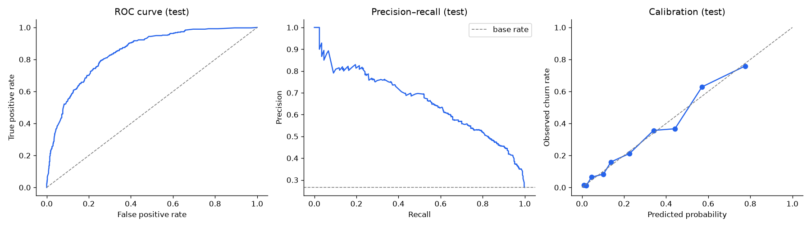
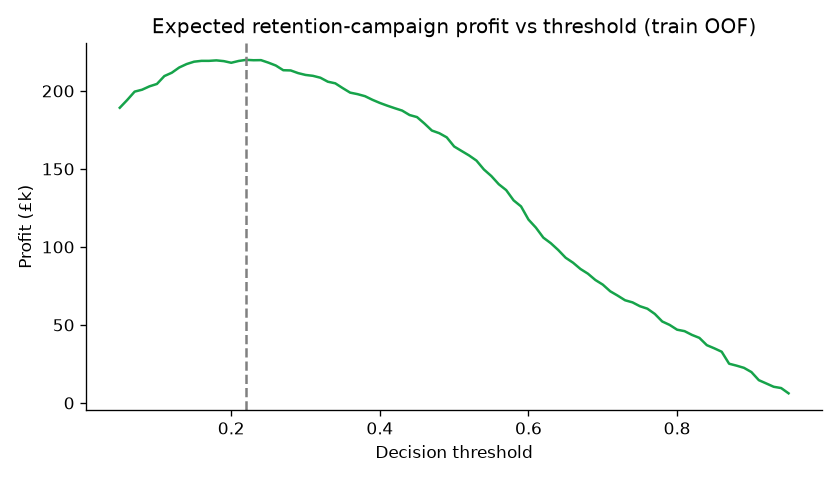
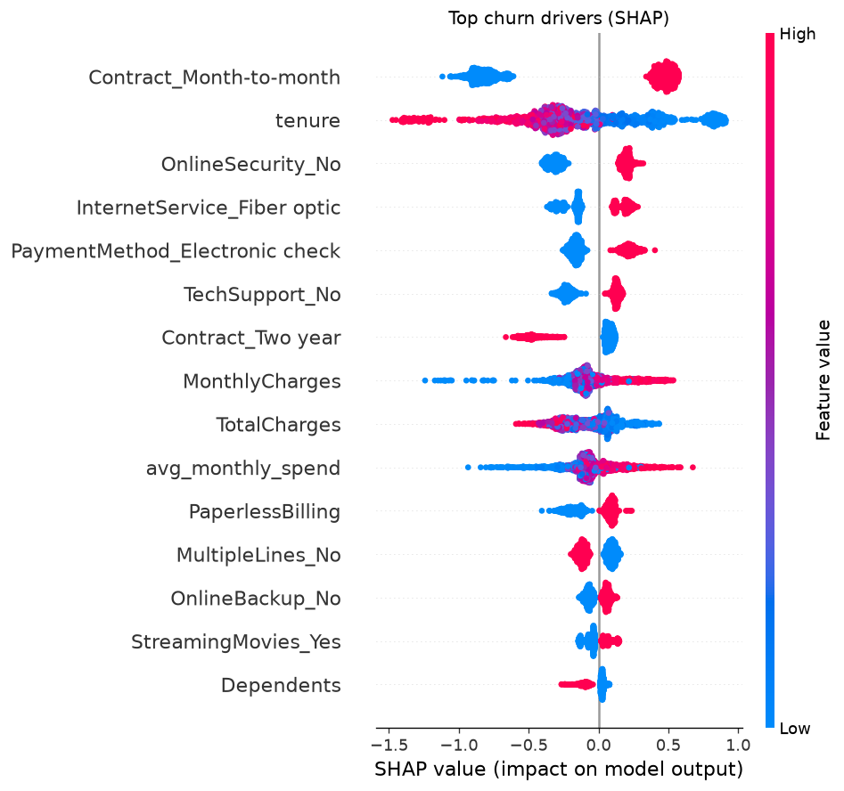

# Customer Churn Prediction — End-to-End ML System


  

Predicts which telecom customers are about to leave, explains **why**, and turns the prediction
into a **business decision** (who should get a retention offer) — packaged as a tested, containerised
REST API with CI.

> Most churn notebooks stop at "accuracy = 80%". This project goes further: model selection with
> cross-validation, probability calibration, a **profit-optimised decision threshold**, SHAP
> explanations, and a production-style serving layer.

## Results (held-out test set, 1,409 customers)

| Metric | Value |
|---|---|
| ROC-AUC | **0.846** |
| PR-AUC (base rate 0.27) | **0.667** |
| Brier score (calibrated) | 0.135 |
| Recall at chosen threshold | **86%** of churners caught |
| Customers targeted | 49% |
| Expected campaign profit vs. "offer everyone" | **£51.8k vs £27.5k (+88%)** |

Model comparison (5-fold stratified CV on training data, PR-AUC):

| Model | CV ROC-AUC | CV PR-AUC |
|---|---|---|
| Logistic Regression | 0.847 | 0.658 |
| Random Forest | 0.845 | 0.655 |
| **XGBoost (selected)** | **0.847** | **0.663** |
| LightGBM | 0.842 | 0.657 |

*Honest note:* a well-regularised logistic regression is nearly as good as gradient boosting on this
dataset — the signal is mostly in a few strong features. XGBoost was kept for its slightly higher
PR-AUC, which matters most for an imbalanced target.



### From probabilities to decisions
A retention offer costs **£50**, succeeds **30%** of the time, and a saved customer is worth
**12 × monthly charges**. The threshold that maximises expected profit is chosen on
**out-of-fold training predictions** (never on the test set), landing at **0.19** — far below the
default 0.5, because missing a churner is much more expensive than a wasted offer.



### What drives churn? (SHAP)
Month-to-month contracts, short tenure, no online security / tech support, fibre internet and
electronic-cheque payment are the strongest churn signals. Two-year contracts are strongly protective.



## Architecture

```
data (IBM Telco, 7,043 customers)
  └─► validate schema ─► clean ─► FeatureBuilder (tenure bands, #services, avg spend)
        └─► ColumnTransformer (scale / ordinal / one-hot)
              └─► 4 candidate models ─► 5-fold CV ─► best by PR-AUC
                    └─► isotonic calibration ─► profit-optimal threshold
                          └─► models/churn_model.joblib  (pipeline + threshold + metadata)
                                └─► FastAPI  /health  /predict  /predict/batch
                                      └─► Docker (multi-stage, non-root, healthcheck) ─► GitHub Actions CI
```

Feature engineering lives **inside** the sklearn pipeline, so the API runs exactly the same
transformations as training — no train/serve skew.

## Quickstart

```bash
make install     # deps + editable install
make train       # downloads data, trains, writes reports/metrics.json
make report      # figures + SHAP
make test        # 10 unit + API tests
make serve       # http://localhost:8000/docs
```

Or with Docker:

```bash
docker build -t churn-api . && docker run -p 8000:8000 churn-api
```

Example request:

```bash
curl -X POST localhost:8000/predict -H "Content-Type: application/json" -d '{
  "gender":"Female","SeniorCitizen":0,"Partner":"No","Dependents":"No","tenure":2,
  "PhoneService":"Yes","MultipleLines":"No","InternetService":"Fiber optic",
  "OnlineSecurity":"No","OnlineBackup":"No","DeviceProtection":"No","TechSupport":"No",
  "StreamingTV":"Yes","StreamingMovies":"No","Contract":"Month-to-month",
  "PaperlessBilling":"Yes","PaymentMethod":"Electronic check",
  "MonthlyCharges":85.5,"TotalCharges":171.0}'
```
```json
{"churn_probability": 0.8031, "will_churn": true, "risk_band": "high", "recommend_retention_offer": true}
```

## Project structure

```
├── src/churn/
│   ├── config.py      # paths, feature lists, business assumptions
│   ├── data.py        # download, schema validation, cleaning
│   ├── features.py    # FeatureBuilder + ColumnTransformer
│   ├── train.py       # CV model comparison, calibration, threshold, artefact
│   └── report.py      # ROC/PR/calibration, profit curve, SHAP
├── api/main.py        # FastAPI service with Pydantic validation
├── tests/             # data, feature and API tests
├── Dockerfile         # multi-stage build
└── .github/workflows/ci.yml
```

## Data
[IBM Telco Customer Churn](https://github.com/IBM/telco-customer-churn-on-icp4d) — 7,043 customers,
20 features, 26.5% churn. Downloaded automatically on first run.

## Possible extensions
- Experiment tracking with MLflow; model registry
- Drift monitoring (PSI on input features) and scheduled retraining
- Uplift modelling to target customers who are *persuadable*, not just at risk
